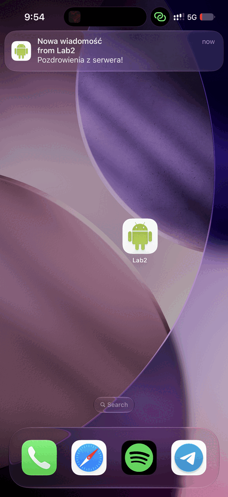
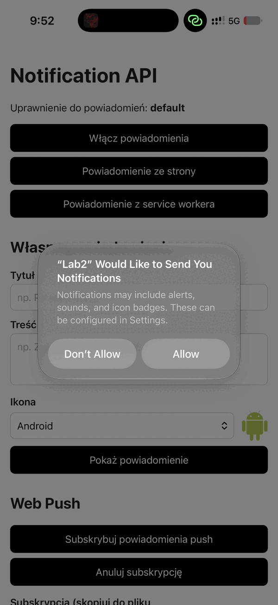
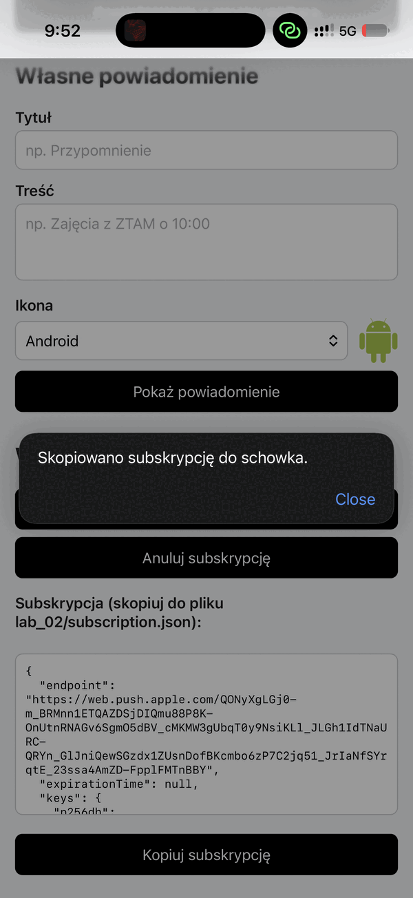
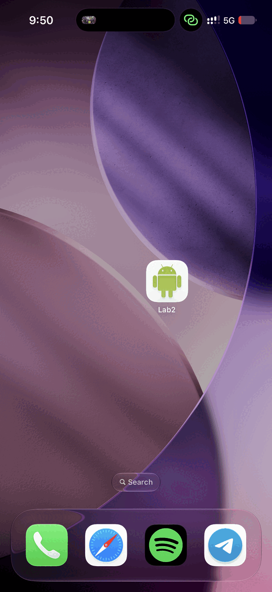

# Lab 2 — Powiadomienia i Web Push

Aplikacja: https://ar1mi.github.io/ZTAM/lab_02/public/

## Co zawiera

- `public/` — strona publikowana w Internecie:
  - przycisk **Włącz powiadomienia** (zgoda dopiero po kliknięciu) i aktualny stan uprawnienia,
  - powiadomienie przez `new Notification()` i przez service workera,
  - formularz (tytuł, treść, ikona z listy) — powiadomienie przez service workera, pusty tytuł nie przechodzi walidacji,
  - Web Push: subskrypcja, anulowanie subskrypcji, kopiowanie subskrypcji,
  - `service-worker.js` — obsługa `push` oraz `notificationclick` (przywołuje otwarte okno aplikacji albo otwiera nowe).
- `generate-keys.mjs` — generuje klucze VAPID do `vapid-keys.json` (plik w `.gitignore`).
- `send-push.mjs` — wysyła powiadomienie na subskrypcję z `subscription.json` (plik w `.gitignore`).

## Uruchomienie

```bash
npm install
node generate-keys.mjs                                   # klucz publiczny -> public/notification.js
npx serve public                                         # http://localhost:3000
node send-push.mjs "Nowa wiadomość" "Pozdrowienia z serwera!"
```

## Powiadomienie push na telefonie

Test na iPhonie: aplikacja dodana do ekranu początkowego (Safari → Udostępnij → Do ekranu początkowego), powiadomienie wysłane poleceniem `node send-push.mjs "Nowa wiadomość" "Pozdrowienia z serwera!"` przy zamkniętej aplikacji (status `201`).

| Powiadomienie push | Zgoda na powiadomienia | Subskrypcja | Zainstalowana aplikacja |
| --- | --- | --- | --- |
|  |  |  |  |
