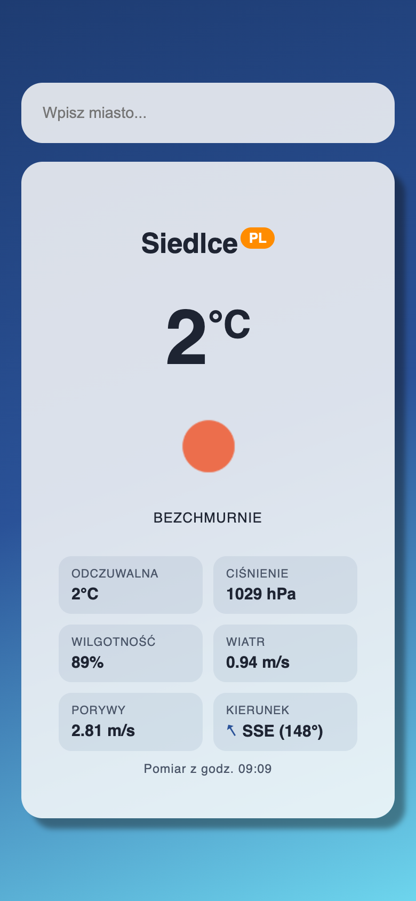
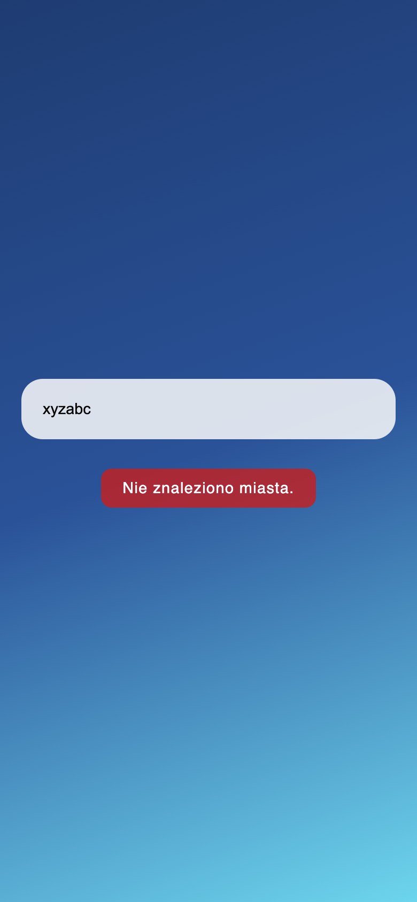
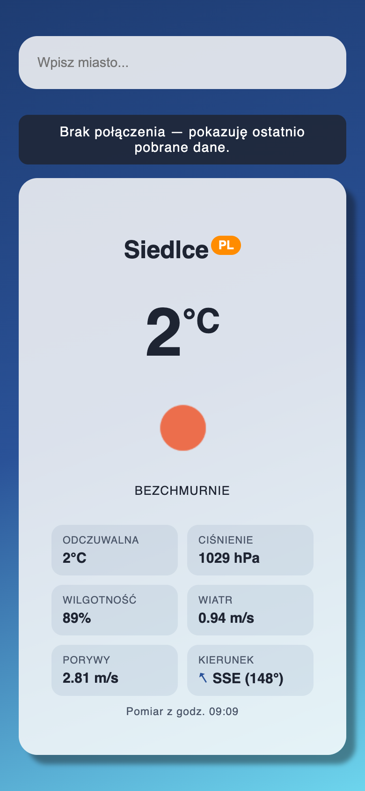
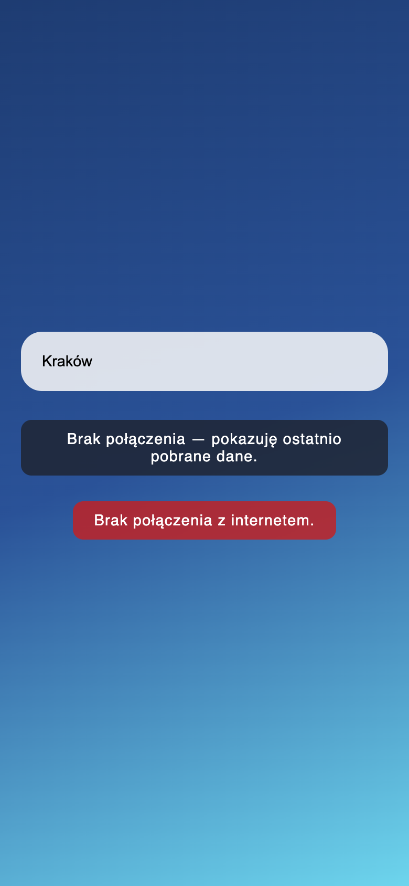
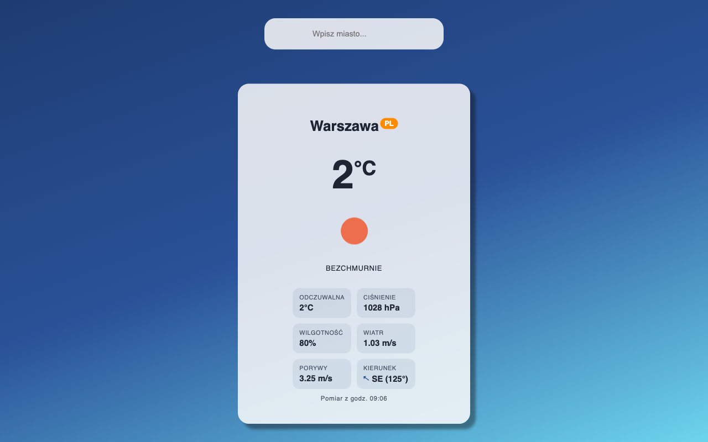

# Lab 3 — Weather App: komunikacja sieciowa w PWA

Aplikacja: https://ar1mi.github.io/ZTAM/lab_03/

Aplikacja pogodowa w **React + Vite**: pobiera bieżącą pogodę z API **OpenWeatherMap** (`fetch()`), obsługuje błędy (nieznane miasto, brak sieci, zły klucz) i jako **PWA** (`vite-plugin-pwa` / Workbox) działa bez połączenia: pokazuje ostatnio pobraną pogodę.

## Uruchomienie

Wymagany Node.js 20.19+ (lub 22.12+).

```bash
npm install
npm run dev        # tryb deweloperski: http://localhost:5173 (bez service workera)
npm run build      # wersja produkcyjna -> dist/
npm run preview    # podgląd wersji produkcyjnej: http://localhost:4173 (z service workerem)
```

Klucz API jest w [`src/api/fetchWeather.js`](src/api/fetchWeather.js) (klucz prowadzącego z instrukcji, własny wpisuje się w stałej `API_KEY`).

## Zrzuty ekranu

Widok telefonu (390×844). Zrzuty offline zrobione na zbudowanej wersji (`build` + `preview`) przy wyłączonej sieci.

| Pogoda dla miasta | Nieznane miasto | Offline: dane z cache | Offline: miasto spoza cache |
| --- | --- | --- | --- |
|  |  |  |  |

Zrzut szeroki (używany też w manifeście jako `screenshots`, `form_factor: 'wide'`):



## Struktura

| Plik | Zawartość |
| --- | --- |
| [`src/api/fetchWeather.js`](src/api/fetchWeather.js) | zapytanie do API (`URLSearchParams`, `fetch`), błędy 404/401/inne i brak sieci |
| [`src/App.jsx`](src/App.jsx) | formularz, stany `query`/`weather`/`error`/`loading`/`online`, karta pogody |
| [`src/App.css`](src/App.css) | style z materiałów + dodatki (siatka szczegółów, komunikat offline) |
| [`vite.config.js`](vite.config.js) | konfiguracja PWA: manifest, ikony, `runtimeCaching` |
| `public/` | favicon (własna ikona SVG), ikony PWA z `@vite-pwa/assets-generator`, zrzuty do manifestu |

## Zadania

1. **Temperatura**: `Math.round(weather.main.temp)` w elemencie `.city-temp`, `°C` w `<sup>`.
2. **Pogoda**: ikona (`.city-icon`, opis w `alt`) i opis pogody w `<div className="info">`. Dodatkowo siatka szczegółów:
   - temperatura odczuwalna,
   - ciśnienie (hPa), wilgotność (%),
   - prędkość wiatru (m/s), **porywy tylko gdy `wind.gust` istnieje**,
   - kierunek wiatru w stopniach **i jako strona świata** (16 kierunków: N, NNE, NE, …, NNW) ze strzałką obróconą w stronę, w którą wieje wiatr.
3. **Aktualność danych**: godzina pomiaru (`new Date(weather.dt * 1000).toLocaleTimeString('pl-PL', …)`) i stan `online` (`navigator.onLine` + zdarzenia `online`/`offline` w `useEffect`, sprzątane przy odmontowaniu). Offline nad kartą jest komunikat *Brak połączenia — pokazuję ostatnio pobrane dane.*
4. **Instalacja**: manifest bez ostrzeżeń, bo dodane są pole `id` i `screenshots` (szeroki z `form_factor: 'wide'` i wąski), zadanie dla chętnych.

## Praca offline: jak to działa

- **Precache**: pliki aplikacji (HTML, JS, CSS, ikony, manifest) zapisuje service worker wygenerowany przez Workbox, więc strona wczytuje się bez sieci.
- **`NetworkFirst`** dla `api.openweathermap.org` (cache `weather-api`, limit 20 odpowiedzi / 24 h, timeout sieci 5 s). Nazwa miasta jest zamieniana na małe litery, więc „Siedlce” i „siedlce” trafiają w ten sam wpis w cache.
- **`CacheFirst`** dla ikon `openweathermap.org/img/` (cache `weather-icons`).

> **Poprawka względem instrukcji.** Ikona wczytywana przez `` z innej domeny daje odpowiedź *opaque* (status 0), a `CacheFirst` w Workboxie domyślnie takich odpowiedzi **nie zapisuje**. Z konfiguracją z instrukcji cache `weather-icons` zostawał pusty i offline nie było ikony. Dodałem `cacheableResponse: { statuses: [0, 200] }`.

Zawartość Cache Storage po wyszukaniu Siedlec i Warszawy (odczyt `caches.keys()` w zbudowanej wersji):

```text
workbox-precache-v2-…   index.html, assets/index-….js, assets/index-….css, ikony, manifest.webmanifest (12 plików)
weather-api             …/data/2.5/weather?q=siedlce&units=metric&lang=pl&appid=…
                        …/data/2.5/weather?q=warszawa&units=metric&lang=pl&appid=…
weather-icons           https://openweathermap.org/img/wn/01d@2x.png
```

## Test offline i instalacji

Sprawdzone automatycznie w Chrome (Playwright, profil z zainstalowanym service workerem):

1. `npm run build && npm run preview`: service worker przejmuje stronę (`navigator.serviceWorker.controller` ≠ `null`).
2. Wyszukanie *Siedlce*, *Warszawa*: odpowiedzi trafiają do `weather-api`.
3. Ponowne uruchomienie przeglądarki **bez sieci** (`navigator.onLine === false`, wszystkie domeny poza `localhost` nieosiągalne, także dla service workera): strona wczytuje się z precache.
4. *Siedlce* → karta z ostatnimi danymi i ikoną z cache, komunikat offline. *Kraków* (nie było w cache) → **Brak połączenia z internetem.**
5. Instalacja (CDP `Page.getAppManifest`, `Page.getInstallabilityErrors`, `PWA.install`): manifest bez błędów, brak błędów instalowalności, aplikacja zainstalowana i uruchomiona jako osobna aplikacja (`appId` = `http://localhost:4173/`).

Ręcznie: DevTools → **Application** → *Service workers* (`sw.js` *activated and is running*) / *Cache storage*, potem **Network** → *Offline*, F5.

## Publikacja

Workflow [`.github/workflows/pages.yml`](../.github/workflows/pages.yml) buduje aplikację z `BASE_PATH=/ZTAM/lab_03/` (w [`vite.config.js`](vite.config.js) z tej zmiennej ustawiane są `base` i `id` manifestu) i publikuje `dist/` na GitHub Pages.

## Klucz API

Klucz w kodzie aplikacji przeglądarkowej i tak jest widoczny (zakładka Network), a darmowy klucz OpenWeatherMap ma niski limit, więc trzymanie go w repozytorium nie jest groźne. Klucze do płatnych usług trzyma się na serwerze.
