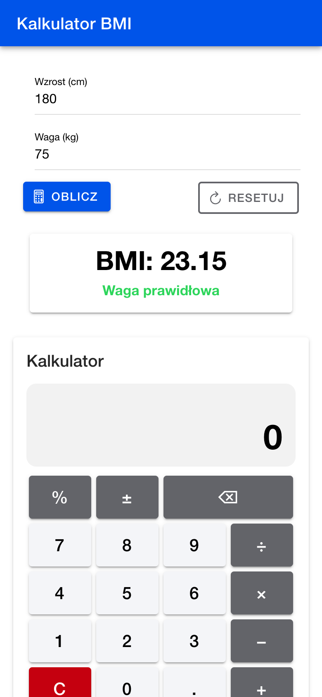
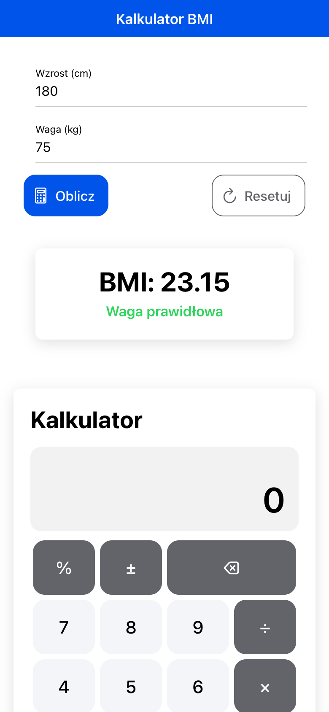
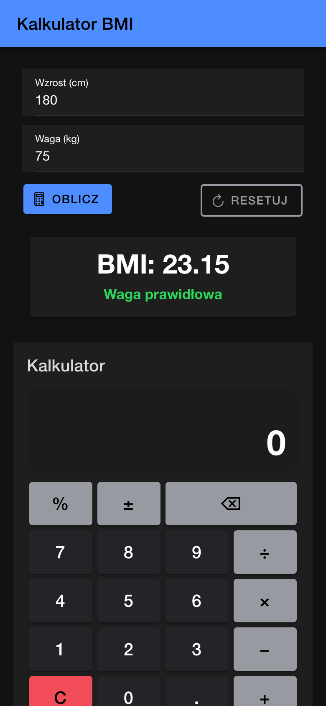
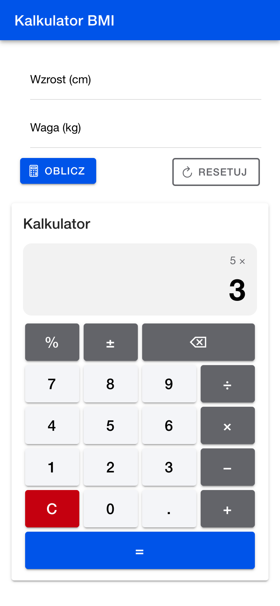
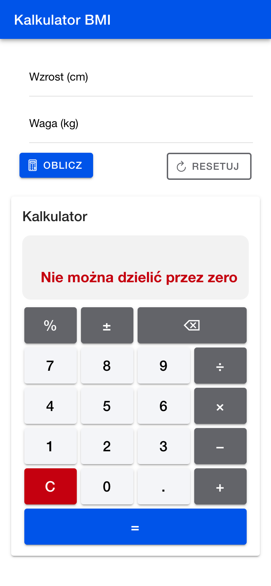
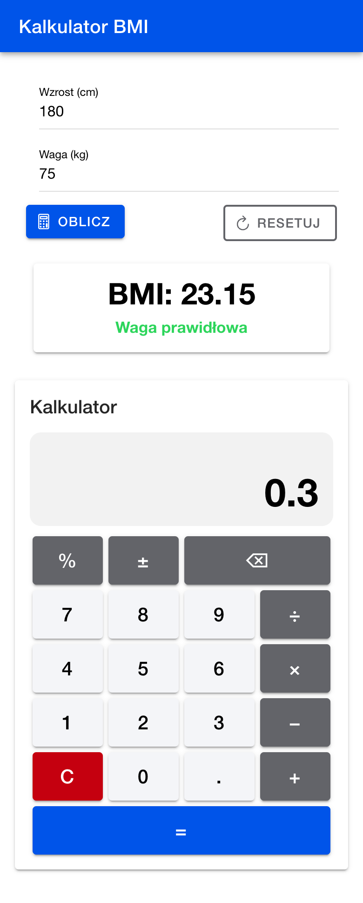

# Lab 4 — Pierwsza aplikacja w Ionic React

Aplikacja: https://ar1mi.github.io/ZTAM/lab_04/

Projekt **Ionic React** (szablon `blank`) z dwoma kalkulatorami: **kalkulatorem BMI** (`useRef` + `useState`) i **kalkulatorem na wzór kalkulatora z Windowsa** jako osobnym komponentem.

## Uruchomienie

```bash
npm install
ionic serve          # albo: npm run dev (bez globalnego CLI: npx @ionic/cli serve)
```

Aplikacja działa pod http://localhost:8100. Styl iOS: http://localhost:8100/?ionic:mode=ios.

Projekt utworzony poleceniem `ionic start lab_04 blank --type=react --no-git` (Ionic CLI 7, `@ionic/react` 9). Testy (`npm test`) wymagają Node.js 22+, bo `jsdom` 30 nie działa na Node 20.

> Aktualny szablon `blank` różni się od opisu w instrukcji: zamiast Cypressa ma testy Playwright (`e2e/`, `playwright.config.ts`) i nie dodaje już Capacitora. Szablonowe testy zastąpiłem własnymi (opis niżej), więc zostają w repozytorium.

## Zrzuty ekranu

Widok telefonu (390×844).

| BMI: Material Design (`md`) | BMI: iOS (`ios`) | BMI: tryb ciemny |
| --- | --- | --- |
|  |  |  |

| Kalkulator: `9 − 4 =`, potem `× 3` | Wynik `= 15` | Dzielenie przez zero | Cała strona |
| --- | --- | --- | --- |
|  |  |  |  |

Różnice `md` i `ios` widać na zrzutach: w `md` tytuł jest z lewej, a napisy na przyciskach WIELKIMI LITERAMI. W `ios` tytuł jest wyśrodkowany, a przyciski bardziej zaokrąglone.

## Struktura

| Plik | Zawartość |
| --- | --- |
| [`src/App.tsx`](src/App.tsx) | nagłówek, kalkulator BMI (zadania 1–2), wstawienie `<Kalkulator />` |
| [`src/components/Kalkulator.tsx`](src/components/Kalkulator.tsx) | kalkulator (zadanie 3): stan, przyciski, klawiatura |
| [`src/components/obliczenia.ts`](src/components/obliczenia.ts) | czyste funkcje `licz()` i `formatuj()` (bez `eval`) |
| [`src/App.test.tsx`](src/App.test.tsx) | testy jednostkowe (Vitest) |
| [`e2e/app.spec.ts`](e2e/app.spec.ts) | testy end-to-end (Playwright, widok Pixel 7) |

Usunięte z szablonu: routing, `src/pages`, `src/components/ExploreContainer`.

## Zadanie 1–2: kalkulator BMI

- `IonHeader` → `IonToolbar` → `IonTitle`, `IonContent` z `ion-padding`, siatka `IonGrid` → `IonRow` → `IonCol` → `IonItem` → `IonInput` (`labelPlacement="floating"`, `type="number"`).
- Przyciski **Oblicz** / **Resetuj** z ikonami `calculatorOutline` / `refreshOutline` (`ionicons/icons`), w kolumnach `ion-text-left` / `ion-text-right`.
- Wartości z pól przez `useRef<HTMLIonInputElement>`, wynik w stanie `useState<number>()`, a karta z wynikiem pojawia się tylko po obliczeniu (`{obliczoneBMI && …}`). *Resetuj* czyści pola i ukrywa kartę.
- Dodatkowo: kategoria BMI wg WHO (niedowaga / waga prawidłowa / nadwaga / otyłość) w kolorze i komunikat przy pustych lub niedodatnich wartościach.

Sprawdzenie: 180 cm i 75 kg dają **BMI: 23.15**.

## Zadanie 3: kalkulator

Wymagania:

- wyświetlacz w `<h1>`, wartość w stanie (`useState`), nie w `IonInput`,
- przyciski w `IonGrid` w 4 kolumnach (`7 8 9 ÷ / 4 5 6 × / 1 2 3 − / C 0 . + / =`),
- wynik można użyć dalej: `9 − 4 =` → `5`, potem `× 3 =` → `15`,
- `C` czyści wszystko, druga kropka w liczbie jest ignorowana,
- dzielenie przez zero pokazuje *Nie można dzielić przez zero*,
- **bez `eval()` / `new Function()`**: działanie liczy `switch` w [`licz()`](src/components/obliczenia.ts),
- zaokrąglanie `parseFloat(wynik.toFixed(10))`, więc `0.1 + 0.2 = 0.3`.

Dla chętnych, wszystko zrobione:

- **`±`**: zmiana znaku,
- **`%`**: jak w Windowsie, przy `+`/`−` procent od pierwszej liczby (`200 + 10 % =` → `220`), przy `×`/`÷` i bez działania dzielenie przez 100,
- **`⌫`**: usuwa ostatnią cyfrę (wyniku nie edytuje),
- **liczenie łańcuchowe**: `2 + 3 +` od razu pokazuje `5`. Nad wyświetlaczem jest bieżące wyrażenie (`5 +`), a wybrane działanie jest podświetlone,
- **klawiatura**: cyfry, `. ,`, `+ - * /`, `Enter`/`=`, `Backspace`, `Esc`/`Delete`/`c`, `%`. Klawisze nie są przechwytywane, gdy kursor jest w polach BMI.

## Testy

```bash
npm run test:unit                 # Vitest: licz(), formatuj(), render aplikacji
npx playwright install chromium   # jednorazowo (albo PW_CHANNEL=chrome, żeby użyć zainstalowanego Chrome)
npm run test:e2e                  # Playwright: BMI + wszystkie scenariusze kalkulatora
npm run lint                      # ESLint + typecheck + Prettier
```

Wynik: 5/5 testów jednostkowych i 8/8 testów e2e (BMI 23.15, reset, walidacja, `9 − 4 = × 3 =` → 15, `0.1 + 0.2` → 0.3 z ignorowaną drugą kropką, dzielenie przez zero i `C`, łańcuch `2 + 3 +`, `±`/`%`/`⌫`, klawiatura).

## Publikacja

Workflow [`.github/workflows/pages.yml`](../.github/workflows/pages.yml) uruchamia lint i testy jednostkowe, buduje aplikację z `BASE_PATH=/ZTAM/lab_04/` (`base` w [`vite.config.ts`](vite.config.ts)) i publikuje ją na GitHub Pages.
